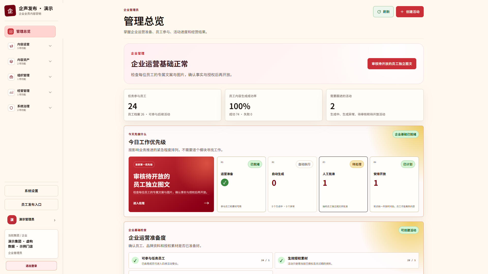
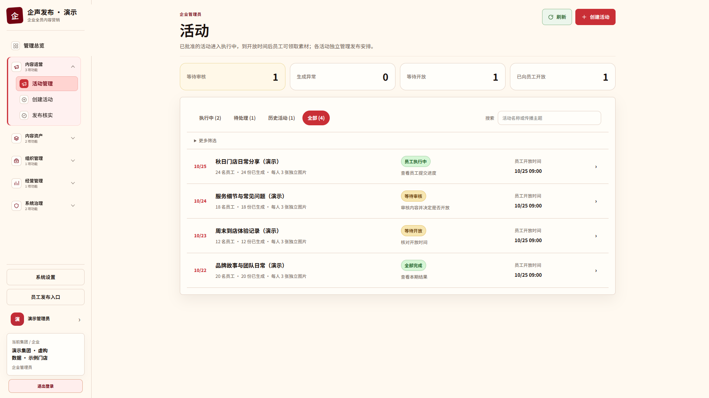
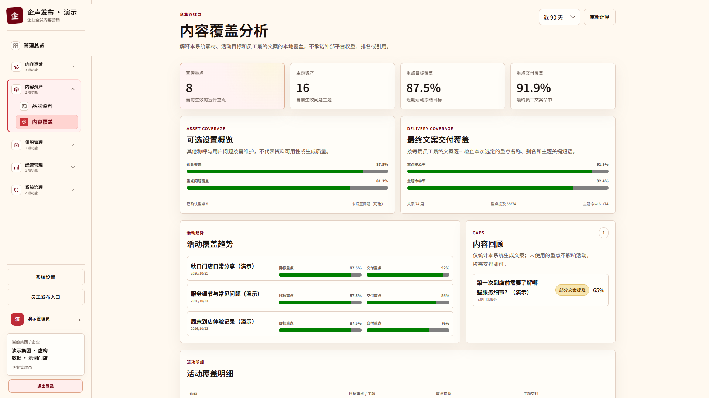
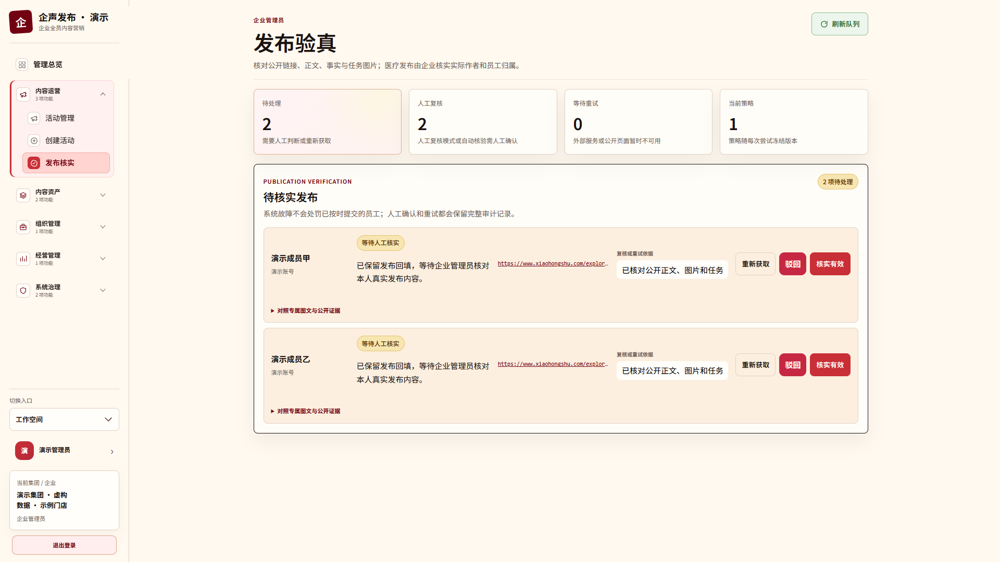
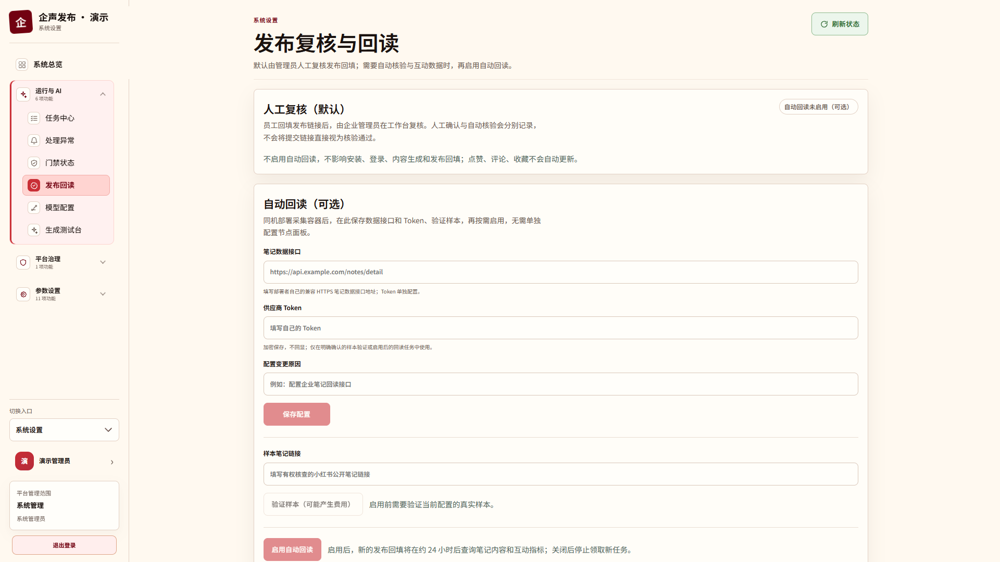
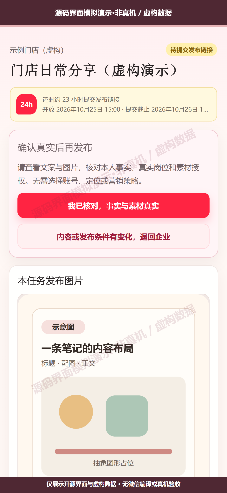
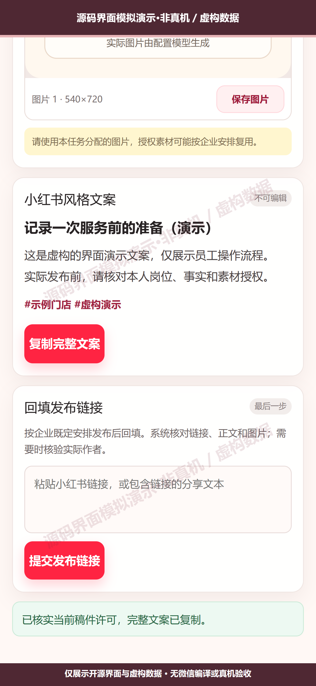

# 企声发布

**面向小红书企业全员营销的自托管协作系统，让企业资料成为员工可以真实分享的内容，并用 GEO 内容覆盖检查保持品牌表达一致。**

[操作说明](docs/user-guide.md) · [部署与常见问题](docs/deployment.md) · [员工微信小程序](docs/miniapp.md) · [版本记录](CHANGELOG.md) · [参与贡献](CONTRIBUTING.md) · [Apache-2.0](LICENSE)

一套安装服务一家企业或一个集团。管理员维护资料、配置模型、组织活动并审核内容；员工确认当前内容符合真实情况，再手动发布到小红书并回填链接。新安装默认本机存储、人工复核，无需先购买 S3、配置域名或部署独立 Worker 服务器。

## 1. 项目解决什么问题

企业做全员营销，需要的不只是批量生成文案：资料要有依据，员工要有独立表达，内容要经过审核，发布后也要能跟进。企声发布将这些工作连接成一条协作流程：

**企业资料与授权素材 → 活动要求 → 员工独立图文 → 企业审核 → 员工确认真实 → 手动发布 → 链接回填与复核 → 内部效果复盘。**

适用于单体企业、门店、连锁机构与集团。集团可以维护多家企业，员工和业务管理员按授权范围协作。

| 能力 | 可以完成的工作 |
| --- | --- |
| 企业资料与素材 | 整理文字、文档及图片，维护授权、结构化事实和历史版本。 |
| 活动与独立内容 | 设置宣传重点、内容方向和图片风格，为参与员工生成独立图文。 |
| 审核与真实性确认 | 保留图文安全审核、人工批准和员工对当前版本的真实性确认。 |
| 员工发布协作 | 领取任务、复制图文、手动发布、提交链接和处理退回。 |
| 发布复核与回读 | 默认人工复核；可选配置数据接口，在同机容器中回读公开笔记及互动指标。 |
| 集团与企业管理 | 管理企业、员工和管理员，保持企业数据范围与功能权限隔离。 |

### GEO 如何参与

这里的 GEO（Generative Engine Optimization，生成式引擎优化）侧重于**组织可信资料、统一品牌实体与别名、围绕用户问题形成内容，并检查最终文案的内部覆盖**。

例如，把品牌、产品、服务场景和常见问题整理为可复用资料，在活动中选择宣传重点，再查看员工最终内容是否提及对应名称、别名或问题主题。

当前覆盖分析基于本系统的资料与文案。它不测量外部生成式引擎的真实引用、搜索排名或推荐权重，也不保证曝光、流量和成交。实际发布由员工在自己的小红书账号中完成。

### 后台演示

以下图片直接截取自本项目真实页面，原生视口均为 **1920 × 1080**。组织、成员、活动和统计数值均为隔离环境中的**虚构演示数据**，用于展示界面与流程，不是客户案例或实际营销效果。

#### 运营工作台



#### 活动管理



#### GEO 内容覆盖



#### 发布人工复核



#### 可选自动回读



## 2. 怎样使用

1. **安装与登录**：Docker 基础部署后访问服务器 IP 加端口，在网页中创建主管理员和组织，完成后进入工作台。没有公开注册入口。
2. **完成业务配置**：默认使用本机存储；按需配置自己的文案、生图和图文审核服务。Embedding 可选，未配置或未验证的必要能力会阻止生成。
3. **维护企业与员工**：单企业直接使用；集团先在后台新增旗下企业，再创建管理员和员工网页账号。
4. **准备资料与活动**：上传有权使用的素材，维护企业事实、宣传重点和可选 GEO 问题主题，创建活动并生成员工独立内容。
5. **审核与发布**：管理员批准内容后开放任务，员工确认当前版本真实，手动发布并回填链接。
6. **复核与复盘**：管理员人工复核发布情况；需要自动数据时再配置回读服务。外部数据缺失时保持未知，不作为零或发布成功处理。

页面说明和角色分工见[操作说明](docs/user-guide.md)。首版保留“运营工作台”和“系统设置”两个入口，使用同一管理员账号与会话；后台入口统一属于后续体验整理。

## 3. 怎样部署

当前 `v0.1.1` 发布源码和固定版本标签，**暂不提供官方预构建镜像**。先在自己的本机或构建机生成镜像，再导入运行主机；直接执行 Compose 不会自动获得尚未发布的 `qisheng/*` 镜像。

已验证的构建目标为 Linux amd64。准备 Node.js 24.21.0 和 Docker，项目依赖由 Docker 构建阶段安装。

```sh
git clone --branch v0.1.1 --depth 1 https://github.com/Yafeiml/qisheng.git
cd qisheng
node deploy/self-host.mjs build v0.1.1
docker save -o qisheng-v0.1.1.tar \
  qisheng/api:v0.1.1 qisheng/web:v0.1.1 \
  qisheng/worker:v0.1.1 qisheng/migrate:v0.1.1
```

将镜像归档及同版本部署文件交付到运行主机。在包含 `deploy/` 的项目目录执行：

```sh
docker load -i /替换为镜像归档的绝对路径/qisheng-v0.1.1.tar
export QISHENG_VERSION=v0.1.1
export QISHENG_DATA_DIR=/srv/qisheng/data
docker compose -f deploy/compose.yml up -d --no-build --pull never
```

访问 `http://服务器IP:3101/setup`。首次安装凭证在受信任的交互终端查看：

```sh
docker compose -f deploy/compose.yml run --rm -it bootstrap token
```

填写管理员与组织后即完成安装，默认本机存储。域名与反向代理按需配置，没有域名不会阻止 IP 加端口访问。普通部署同时启动 API、Web 和内容 Worker。

完整步骤以[部署与常见问题](docs/deployment.md)为准，包括源码构建与交付、1Panel／已有数据库、持久化目录、反向代理、模型与审核门禁、S3 切换限制、同机回读、升级和恢复。Windows 构建机使用现有 WSLC Linux 容器环境；运行主机使用已经构建的镜像。

### 配对员工微信小程序

小程序源码位于 `apps/employee-miniapp`，也可从 [v0.1.1 Release](https://github.com/Yafeiml/qisheng/releases/tag/v0.1.1) 下载独立源码包。使用自己的 AppID 和已配置微信合法域名的 HTTPS API，通过 `node scripts/miniapp/export.mjs` 导出独立项目，在微信开发者工具中编译、预览并由自己的账号提交审核。具体参数和流程见[小程序自部署说明](docs/miniapp.md)。

默认使用管理员创建的员工账号密码，Web 与小程序访问相同员工任务；短信和微信订阅通知均按需配置。微信通知的 AppSecret 仅保存在服务端，不能放进小程序。源码包不是已上传或审核通过的微信应用。

员工可以查看本人任务，确认当前版本内容真实后复制文案、保存图片，在小红书中手动发布并回填链接。企业仍在工作台审核和复核，不需要为小程序再维护一套员工任务。

#### 小程序界面预览

以下图片使用开源 WXML/WXSS 和页面逻辑，在隔离浏览器中模拟渲染。**均为“源码界面模拟演示·非真机／虚构数据”**，没有连接真实员工账号或供应商，不表示已经通过微信编译、真机验收或审核。点击图片可查看大图。

<table width="100%">
  <tr>
    <th width="25%">1 · 账号登录</th>
    <th width="25%">2 · 员工任务</th>
    <th width="25%">3 · 确认真实</th>
    <th width="25%">4 · 发布回填</th>
  </tr>
  <tr>
    <td width="25%" align="center" valign="top"><a href="docs/images/miniapp-simulated-login.png"></a></td>
    <td width="25%" align="center" valign="top"><a href="docs/images/miniapp-simulated-tasks.png"></a></td>
    <td width="25%" align="center" valign="top"><a href="docs/images/miniapp-simulated-facts.png"></a></td>
    <td width="25%" align="center" valign="top"><a href="docs/images/miniapp-simulated-publication.png"></a></td>
  </tr>
</table>

## 首版范围与依赖

- 模型、内容审核和可选回读接口使用部署者自己的账号，测试及调用费用由相应供应商计收。
- 自动回读默认关闭，需保存自己的配置、明确确认费用并完成真实样本验证后启用。
- 本机存储和 S3 均受文件与任务状态约束；已有文件时不能直接切换后端，首版不自动迁移旧文件。
- 小程序、邮件、短信、CAP 与外部 Embedding 属于可选接入，各自仍有独立配置和外部验收要求。
- 企业资料、图片、员工内容及账号由部署者管理。请使用有授权的素材，并遵守相应平台与行业规则。
- 当前未给出经过完整容量测试的生产最低硬件规格，批量生成前需按实际并发和文件规模验证。

## 开发与参与

工具链为 Node.js 24.21.0、pnpm 12.6.0，迁移和依赖版本以源码及锁文件为准。开发环境使用自己的数据库、Redis 前缀、存储与密钥。准备步骤和检查命令见[贡献说明](CONTRIBUTING.md)。

问题反馈：[GitHub Issues](https://github.com/Yafeiml/qisheng/issues)。安全问题请按[安全说明](SECURITY.md)处理，不要在公开 Issue 中粘贴密钥、员工信息或数据库导出。

## 许可证

本项目原创代码、新编写的文档和演示图形采用 [Apache License 2.0](LICENSE)，版权署名 **Yafeiml**。允许依照许可证使用、修改、再分发及商业使用；许可证不授予项目名称或标识的商标权。第三方组件继续适用各自许可证，见[第三方声明](THIRD_PARTY_NOTICES.md)。

本仓库公开社区版本。自有商业版本及额外服务可以另行提供，不改变已发布社区版本授予的权利。本项目与小红书不存在官方隶属或授权关系。
